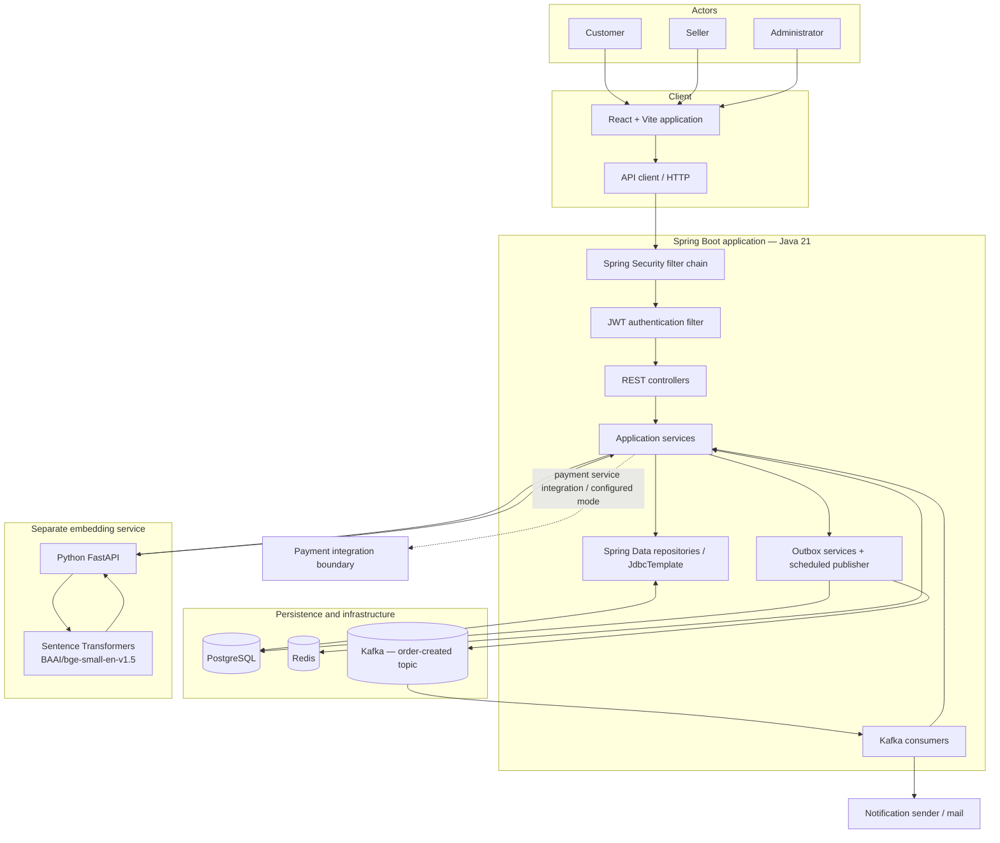
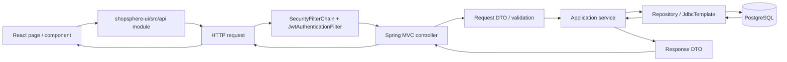
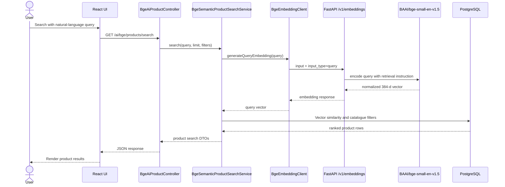
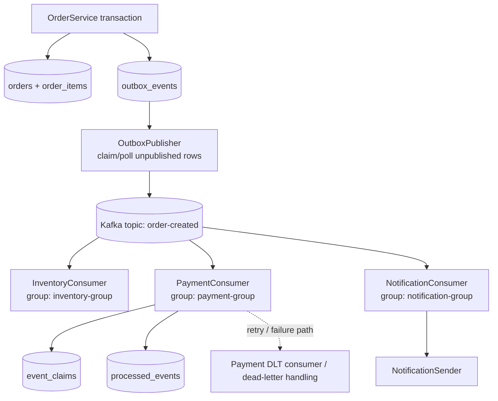
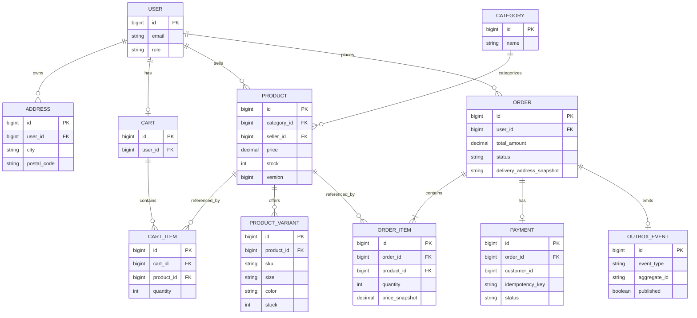
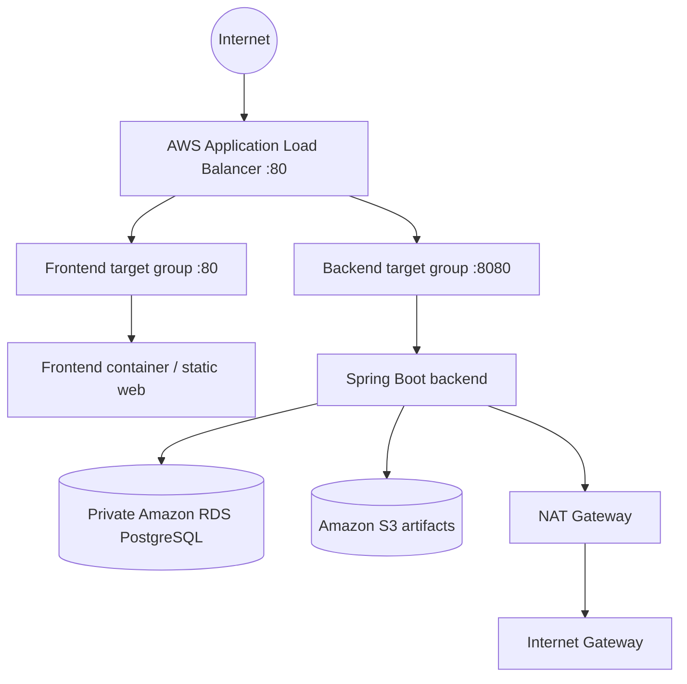

# ShopSphere — Cloud-Native E-Commerce Platform

ShopSphere is a full-stack commerce application with customer, seller and administrator workflows. The repository contains a Java 21 / Spring Boot backend, a React + Vite frontend, PostgreSQL persistence, Redis integration, Kafka-based event processing, and a separate BGE embedding service for semantic product retrieval.

> **Architecture documentation status:** diagrams below describe code and configuration inspected in this repository. They are implementation-oriented design views, not a claim that every optional integration is deployed or enabled in every environment. In particular, AWS resources are documented separately; the public production deployment and a live demo URL are not currently asserted.

## At a glance

| Area | Implementation |
|---|---|
| Frontend | React, Vite, JavaScript |
| Backend | Java 21, Spring Boot 4.1.0, Spring MVC |
| API security | Spring Security, stateless JWT authentication, role-based endpoint rules |
| Persistence | Spring Data JPA / Hibernate, PostgreSQL, JDBC for vector search |
| Cache / coordination integration | Spring Data Redis |
| Event processing | Spring Kafka, PostgreSQL outbox, event claims and processed-event records |
| Semantic retrieval | BAAI `bge-small-en-v1.5` served by Python FastAPI / Sentence Transformers |
| Payments | Payment service supports simulated outcomes and manual UPI / COD verification; Razorpay Java SDK is a declared dependency |
| API documentation | springdoc OpenAPI |
| Build and tests | Maven, JUnit / Spring tests, Testcontainers |
| Frontend build | Vite |
| Containerization / cloud | Docker, Compose, AWS architecture documentation |

## Product capabilities

- Customer registration, authentication, profile and address management
- Product catalogue, category browsing, filtering, images and product variants
- Cart, order creation, customer order history and payment records
- Seller product and inventory operations, seller analytics
- Administrator dashboards and payment verification
- Wishlist and personalized recommendation endpoints
- Semantic product discovery through the BGE embedding path
- Event-driven order processing with an outbox publisher and Kafka consumers

## System architecture — high-level design

This is the system context and major runtime boundaries. The Spring Boot application is the central modular backend; the BGE model is a separate Python service. PostgreSQL is the primary persistence boundary. Redis and Kafka are integration dependencies and their availability depends on deployment configuration.



### Request path and backend layering

For a normal HTTP request, the intended code path is:

1. The React page calls a module under `shopsphere-ui/src/api/`.
2. The API client sends an HTTP request to a Spring MVC controller.
3. The Spring Security filter chain applies CORS, stateless session policy, JWT authentication and URL authorization rules.
4. The controller validates and delegates to an application service.
5. The service applies business rules and transaction boundaries.
6. A repository, JPA entity manager or JdbcTemplate performs persistence work.
7. A DTO is returned through the controller and rendered by React.



### Backend component map

The backend is organized as a modular Spring Boot application, not as separately deployed microservices. The following map groups the actual controller and service areas by business capability.

| Capability | Controller layer | Service layer / collaborators |
|---|---|---|
| Authentication and users | `AuthController`, `UserController` | `AuthService`, `UserService`, `CustomUserDetailsService`, `JwtService` |
| Catalogue | `ProductController`, `CategoryController` | `ProductService`, `CategoryService` |
| Cart and orders | `CartController`, `OrderController` | `CartService`, `OrderService` |
| Payments | `PaymentController` | `PaymentService` |
| Seller operations | `SellerInventoryController`, `SellerAnalyticsController` | `SellerInventoryService`, `SellerAnalyticsService` |
| Product variants and media | `ProductVariantController`, `ProductVariantImageController`, `ProductGalleryController` | `ProductVariantService`, `ProductVariantImageService`, `ProductGalleryService`, `ProductImageService` |
| Addresses | `AddressController` | `AddressService` |
| Admin | `AdminController`, `AdminDashboardController` | `AdminDashboardService` |
| Wishlist | `WishlistController` | `WishlistService` |
| AI discovery | `AiProductController`, `BgeAiProductController` | OpenAI-compatible embedding path and BGE embedding/search services are separate implementations |
| Notifications | Event listener / consumer paths | `NotificationSender`, notification configuration and listener classes |

## AI semantic search — BGE path

The BGE implementation is a distinct service boundary. The Spring Boot backend's `BgeEmbeddingClient` calls the Python FastAPI endpoint `POST /v1/embeddings`. The Python service loads `BAAI/bge-small-en-v1.5` through Sentence Transformers, normalizes vectors, and returns 384-dimensional embeddings. Query inputs receive the BGE retrieval instruction; document inputs are encoded without that query instruction.

Product indexing is exposed through `POST /admin/ai/bge/products/index`. The BGE semantic search endpoint is `GET /ai/bge/products/search`. The service persists product vectors in PostgreSQL's `product_embeddings_bge` table using a PostgreSQL `vector` value and JDBC.



The index build path is separate:

```mermaid
flowchart LR
  ADMIN["Administrator"] --> INDEX["POST /admin/ai/bge/products/index"]
  INDEX --> EMBED["BgeProductEmbeddingService"]
  EMBED --> PRODUCTS["ProductRepository\nload product + category + seller"]
  PRODUCTS --> TEXT["Build product document text"]
  TEXT --> HASH["SHA-256 content hash"]
  HASH --> BATCH["Changed documents\nbatches of up to 32"]
  BATCH --> CLIENT["BgeEmbeddingClient"]
  CLIENT --> FASTAPI["FastAPI embedding endpoint"]
  FASTAPI --> MODEL["BGE model"]
  MODEL --> VECTORS["Normalized 384-d vectors"]
  VECTORS --> UPSERT["JdbcTemplate vector upsert"]
  UPSERT --> PG[("product_embeddings_bge")]
```



**OpenAI distinction:** the repository also contains an `OpenAIEmbeddingService` and a generic semantic-search path. Their presence proves that code exists, not that production traffic uses OpenAI. This README does not claim OpenAI API usage; the BGE route is documented separately.

## Checkout, inventory and payment

The current `OrderService.createOrder` implementation validates address ownership and requested quantities, applies the configured order rate limit, obtains products through `ProductRepository.findByIdForUpdate`, checks available stock, decrements stock, saves the order and writes an `OrderCreated` event through `OutboxService` in the same transactional method.

Payment is a separate API/service operation under `PaymentController` and `PaymentService`. The inspected code supports simulated payment outcomes and manual UPI/COD payment records with idempotency keys and administrator verification. A checkout diagram must therefore not imply that order creation itself synchronously completes a third-party payment.

```mermaid
sequenceDiagram
  actor Customer
  participant UI as React
  participant Security as Spring Security
  participant OC as OrderController
  participant OS as OrderService
  participant Address as AddressRepository
  participant Product as ProductRepository
  participant DB as PostgreSQL
  participant Outbox as OutboxService
  participant PC as PaymentController
  participant PS as PaymentService

  Customer->>UI: Submit checkout
  UI->>Security: POST /orders + JWT
  Security->>OC: Authenticated request
  OC->>OS: createOrderForAuthenticatedUser
  OS->>Address: Verify address belongs to customer
  Address->>DB: SELECT address by id + user id
  DB-->>Address: Address
  OS->>Product: findByIdForUpdate per item
  Product->>DB: Lock product rows
  DB-->>Product: Current stock and price
  OS->>OS: Validate stock; decrement stock; build order
  OS->>DB: Save order and order items
  OS->>Outbox: saveOrderCreatedEvent
  Outbox->>DB: Insert outbox row in same transaction
  DB-->>OS: Transaction commits
  OS-->>OC: OrderResponseDTO
  OC-->>UI: 201 Created
  UI-->>Customer: Show created order
  Customer->>UI: Choose payment method / submit payment
  UI->>Security: POST /orders/{id}/payment/...
  Security->>PC: Authorized request
  PC->>PS: createManualPayment or simulatePayment
  PS->>DB: Lock order; enforce idempotency; save payment
  DB-->>PS: Payment state
  PS-->>PC: PaymentResponseDTO
  PC-->>UI: Payment response
```

### Payment state note

- Manual UPI and COD requests are initially recorded as `PENDING`; the order is set to `PAYMENT_PENDING` or `COD_PENDING`.
- Admin verification can move a manual payment to success or failure. Failure restores the reserved product stock using row locks.
- The simulation path records a successful or failed simulated payment; failed simulation restores reserved stock.
- The Razorpay SDK is declared in Maven dependencies. Do not infer a verified live Razorpay charge flow solely from that dependency.

## Transactional outbox and Kafka

The order service calls `OutboxService.saveOrderCreatedEvent` before the order transaction completes. The outbox row is stored in PostgreSQL with the order operation. `OutboxPublisher` polls claimed unpublished events on a schedule (default delay 5 seconds; batch claim size 20) and publishes `OrderCreated` records to Kafka topic `order-created`. Product cache invalidation is another outbox event type handled by this publisher.

The inspected consumers subscribe to `order-created` using separate consumer groups:
- `inventory-group`: logs the order items it receives; the inspected implementation does not mutate inventory in this listener.
- `payment-group`: uses event claim/recovery and processed-event idempotency services; current code describes its payment work as simulated.
- `notification-group`: loads the customer and sends an order-confirmation notification.



The three groups are independent subscriptions to the same topic; they are not a serial chain. Payment claim/recovery and processed-event records support idempotency and recovery. The DLT component is part of the configured payment error-handling design; the exact topic names and retry policy should be taken from the Kafka configuration before operating or changing a broker.

## Data model — core relationships

The following entity diagram is based on JPA mappings inspected in `entity/`. It intentionally shows the central commerce relationships rather than every audit or infrastructure table. `Order.deliveryAddress` is an embedded snapshot (`OrderAddress`), not a foreign-key relation to the mutable address book.



Additional persistence structures include `product_embeddings_bge`, `processed_events`, `event_claims`, dead-letter records and inventory/payment audit data. See the migration directories and the detailed [data design](docs/architecture/05-data-model.md).

## Security model

- `SecurityConfig` configures stateless sessions, CORS, a JWT authentication filter and URL authorization rules.
- Public routes include health, authentication, Swagger/OpenAPI, public product/category reads, image reads and the read-only AI search paths.
- Product writes require SELLER or ADMIN; administration endpoints require ADMIN; other authenticated routes require a valid authenticated principal unless separately permitted.
- Services also perform ownership checks, such as ensuring an order and delivery address belong to the authenticated customer.
- BCrypt is configured as the password encoder.
- Secrets and database credentials are expected through environment variables; never commit real values.

## Deployment and infrastructure

The repository contains Docker assets and a local Compose configuration. The checked-in `compose.yaml` expects a backend image and a frontend image to be built separately, maps them to localhost ports 8081 and 8082, and expects PostgreSQL/Redis/Kafka to be reachable on the configured host/network. It does not itself define PostgreSQL, Redis or Kafka containers.

The AWS infrastructure design and recovered environment evidence are documented separately:
- [AWS architecture](docs/aws/architecture.md)
- [Network and routing](docs/aws/network-and-routing.md)
- [Security architecture](docs/aws/security-architecture.md)
- [Data and storage](docs/aws/data-and-storage.md)
- [Deployment and recovery](docs/aws/deployment-and-recovery.md)



> **Deployment caveat:** this is the documented target/infrastructure topology. It is not a live-health diagram. The recovered AWS audit found stopped EC2 instances and unhealthy/stopped ALB targets at that time; no public live demo is claimed here.

## Repository layout

```text
.
├── src/main/java/com/abrar/shopsphere/
│   ├── ai/                  # BGE and alternate embedding/search code
│   ├── config/              # Spring, security, Kafka and application config
│   ├── consumer/            # Kafka consumers
│   ├── controller/          # REST API controllers
│   ├── dto/                 # Request/response models
│   ├── entity/              # JPA domain entities
│   ├── event/               # Event contracts
│   ├── notification/        # Notification integration
│   ├── repository/          # Spring Data repositories
│   └── service/             # Business logic and orchestration
├── src/main/resources/db/   # Application Flyway migrations
├── database/migrations/     # Additional/manual migration set
├── shopsphere-ui/           # React + Vite frontend
├── bge-embedding-service/   # Python FastAPI + BGE
├── performance/             # k6 product baseline
├── scripts/                 # Operational scripts
├── docs/
│   ├── architecture/        # Application HLD, LLD and flow diagrams
│   └── aws/                 # Cloud infrastructure documentation
├── compose.yaml
├── Dockerfile
├── pom.xml
└── README.md
```

## Architecture and engineering documentation

| Document | What it explains |
|---|---|
| [System context and HLD](docs/architecture/01-system-context-and-hld.md) | Actors, system boundary, containers and major dependencies |
| [Component and layered design](docs/architecture/02-component-and-layered-design.md) | Controllers, services, repositories and dependency direction |
| [Request and checkout flows](docs/architecture/03-request-checkout-and-payment-flows.md) | API handling, order transaction, inventory locking and payment state |
| [AI / BGE design](docs/architecture/04-ai-bge-semantic-search.md) | Indexing, embeddings, query instructions and vector retrieval |
| [Kafka and outbox design](docs/architecture/05-kafka-outbox-and-consumers.md) | Transactional outbox, publisher, consumer groups, idempotency and failure handling |
| [Data model](docs/architecture/06-data-model.md) | Entity relationships, key constraints and data ownership |
| [Security design](docs/architecture/07-security-and-authorization.md) | JWT, stateless security, endpoint roles and ownership checks |
| [Deployment design](docs/architecture/08-deployment-and-aws.md) | Local Compose topology and AWS infrastructure reference |
| [Diagram source index](docs/architecture/diagrams/README.md) | Editable Mermaid source files |

## Build and test

Backend:

```bash
./mvnw --batch-mode --no-transfer-progress verify
```

Frontend:

```bash
cd shopsphere-ui
npm ci
npm run build
```

The repository's GitHub Actions workflow runs the Maven verification job on pushes and pull requests targeting `main`.

## Current verification snapshot

At the time of the documentation update, the local recovered checkout completed Maven verification with **98 tests, zero failures and zero errors**, and the Vite production build completed successfully. These are local results supplied from the project workflow; they do not establish that the latest GitHub Actions run is green or that cloud infrastructure is currently serving traffic.

## Existing project documents

- [Expanded system architecture and codebase guide](docs/ShopSphere_System_Architecture_and_Codebase_Guide_EXPANDED.docx)
- [Troubleshooting and error-resolution playbook](docs/ShopSphere_Troubleshooting_Error_Resolution_Playbook_EXPANDED.docx)


## Local runbook and product walkthrough

For the Windows/PowerShell startup sequence, local service ports, database verification, environment variables, build/test commands, Docker Compose caveats and current AWS/SSM limitation, see the [Local Development and Deployment Runbook](docs/LOCAL_DEVELOPMENT_AND_DEPLOYMENT.md).

The [Product Walkthrough and Screenshot Gallery](docs/PRODUCT_WALKTHROUGH.md) documents the captured customer, checkout, BGE search and seller-variant screens. Screenshot assets are supplied in the project handoff archive and are intended for the docs/demo-screenshots/ folder.

> **Demo status:** there is currently no public live-demo URL or recorded live demo video. The former SSM port-forward depended on an EC2-managed instance that is stopped. The local runbook documents the separate Windows-host workflow and verification boundaries.

---
