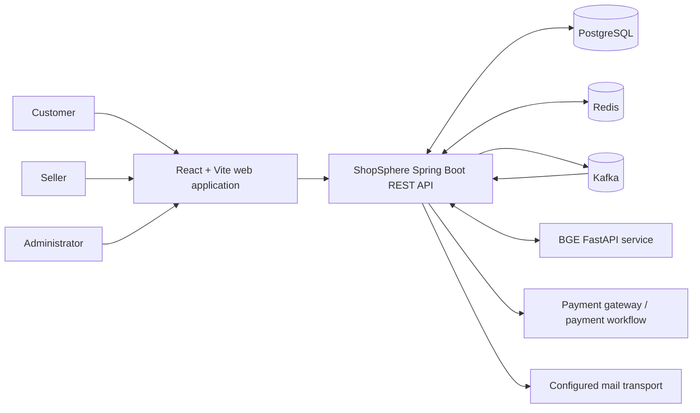
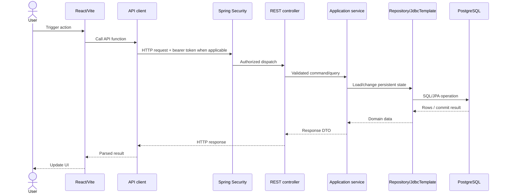

# 01 — System Context and High-Level Design

## 1. Purpose and scope

ShopSphere is implemented as a modular Spring Boot application with a React/Vite client, PostgreSQL persistence, Redis integration, Kafka event processing and a separately hosted BGE embedding service. This document describes the system boundary and the principal component responsibilities found in the repository.

This is an implementation-oriented HLD. It is not a claim that the backend is decomposed into independently deployed domain microservices. The controllers, services, repositories and consumers are compiled into one Spring Boot application.

## 2. System context

The arrows show integration boundaries. Some capabilities are conditional on application properties and environment-specific services. The actual code path and status of each integration must be checked for the environment being discussed.

## 3. Container / deployable-unit view

| Unit | Technology | Responsibility |
|---|---|---|
| Web client | React + Vite | User interfaces and calls to backend APIs |
| Main application | Java 21, Spring Boot 4.1.0 | API, authorization, business rules, persistence orchestration and Kafka producers/consumers |
| Relational database | PostgreSQL | Users, catalogue, carts, orders, payments and operational event state |
| Cache / integration | Redis | Spring Data Redis integration; outbox publisher also uses Redis for product cache invalidation |
| Message broker | Kafka | Asynchronous `order-created` event distribution to independent consumer groups |
| Embedding API | Python, FastAPI, Sentence Transformers | Creates query and product-document embeddings with BGE |

## 4. Major business capabilities

- Identity: registration, login, JWT, user/profile operations and password reset.
- Catalogue: products, categories, product variants, gallery/images and search.
- Shopping: cart, addresses, order creation and customer order history.
- Payments: manual UPI/COD and simulated payment workflows with payment status and idempotency.
- Seller: product ownership, inventory operations and analytics.
- Administration: admin dashboard and manual payment verification.
- AI discovery: two embedding/search code paths exist; the BGE route is separately exposed by `BgeAiProductController`.
- Event processing: PostgreSQL outbox publishing, Kafka consumers, claim/recovery and processed-event state.
- Notifications: notification listener and sender abstractions.

## 5. Main user request path

## 6. Quality and design concerns

- Keep business rules in services rather than duplicating them in React.
- Keep persistence access behind repositories or an explicitly documented JDBC adapter.
- Use DTOs at the API boundary; do not expose JPA entities as public API contracts.
- Keep authentication at the filter/authorization layer and enforce resource ownership inside services.
- Keep transaction boundaries around multi-row invariants such as stock reservation, order persistence and outbox insertion.
- Treat event delivery as asynchronous and potentially repeated; consumers must be idempotent.
- Keep BGE as a separate model-serving boundary and validate embedding dimensions/model identity at the client boundary.
- Use configuration/environment variables for credentials and deployment endpoints.

## 7. Known design distinctions

- The current `OrderService` creates and persists the order and decrements product stock in a transaction. It does not synchronously invoke `PaymentService`.
- Payment initiation/verification is performed by separate `PaymentController` endpoints.
- The `InventoryConsumer` currently logs item details from `OrderCreatedEvent`; the inspected listener does not perform stock mutation.
- `PaymentConsumer` currently describes its payment handling as simulated and uses claim/idempotency collaborators.
- The Compose file defines backend and frontend containers only. It expects PostgreSQL, Redis and Kafka to be provided outside that Compose file.
- AWS diagrams describe the documented infrastructure topology, not verified current service health.
