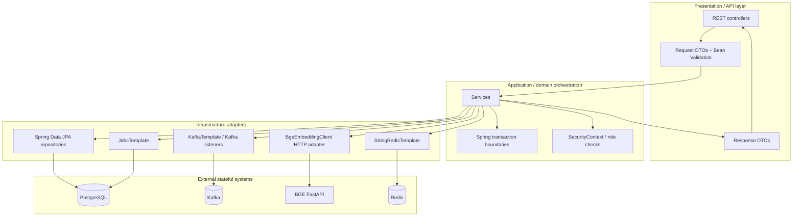
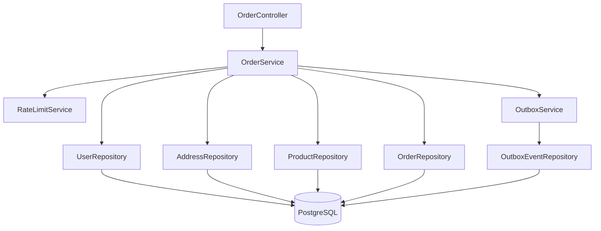

# 02 — Component Architecture and Layered Design

## 1. Architectural style

The backend is a **modular monolith**: one Spring Boot deployable contains the HTTP controllers, business services, data repositories, Kafka consumers and event infrastructure. The Python embedding API is a separate deployable service.

The main backend package is `com.abrar.shopsphere`.

## 2. Layer responsibility

## 3. Controller inventory

| Controller | Responsibility / visible endpoint family |
|---|---|
| `AuthController` | Authentication endpoints under `/auth/**` |
| `UserController` | User/profile endpoints |
| `ProductController` | Product catalogue and product management |
| `CategoryController` | Category catalogue and management |
| `CartController` | `/cart` and `/cart/items` operations |
| `OrderController` | `/orders`, order history and order lookup |
| `PaymentController` | Order payment endpoints and admin payment verification |
| `AddressController` | Customer address operations |
| `SellerInventoryController` | Seller inventory endpoints |
| `SellerAnalyticsController` | Seller analytics |
| `AdminController`, `AdminDashboardController` | Administration APIs |
| `WishlistController` | Wishlist operations |
| `ProductVariantController`, `ProductVariantImageController` | Variant and variant image operations |
| `ProductGalleryController` | Product gallery operations |
| `AiProductController` | Alternate semantic search/indexing path |
| `BgeAiProductController` | BGE index and search path |
| `PersonalizedRecommendationController` | Personalized recommendation endpoints |
| `PasswordResetController` | Password-reset flow |

## 4. Service and repository mapping

| Business area | Services / collaborators | Main persistence adapters |
|---|---|---|
| Identity | `AuthService`, `UserService`, `JwtService`, `CustomUserDetailsService` | `UserRepository` |
| Catalogue | `ProductService`, `CategoryService` | `ProductRepository`, `CategoryRepository` |
| Cart | `CartService` | `CartRepository`, `CartItemRepository` |
| Orders | `OrderService`, `OutboxService`, `RateLimitService` | `OrderRepository`, `ProductRepository`, `AddressRepository`, `OutboxEventRepository` |
| Payments | `PaymentService` | `PaymentRepository`, `OrderRepository`, `ProductRepository` |
| Seller | `SellerInventoryService`, `SellerAnalyticsService` | Product, variant, inventory-related repositories |
| Variants | `ProductVariantService`, `ProductVariantImageService` | `ProductVariantRepository` and related persistence adapters |
| Wishlist | `WishlistService` | Wishlist persistence collaborators |
| AI BGE | `BgeProductEmbeddingService`, `BgeSemanticProductSearchService`, `BgeEmbeddingClient` | `ProductRepository`, `JdbcTemplate` |
| Event processing | `OutboxPublisher`, claim/recovery/idempotency/completion services | Outbox, event claim, processed event and dead-letter repositories |
| Notifications | `NotificationSender`, notification listener/configuration | `UserRepository` and configured mail transport |

## 5. Example: order creation dependency graph

The following is a direct service dependency view derived from `OrderService` constructor fields and its `createOrder` method.

## 6. Dependency direction

- Controllers depend on services.
- Services depend on repositories and infrastructure adapters.
- Repositories map entities and queries to PostgreSQL.
- DTOs are API contracts; entities model persistence.
- Kafka listeners are inbound adapters for asynchronous messages.
- The BGE HTTP client is an outbound adapter from Spring Boot to Python FastAPI.
- The BGE service does not call back into Spring Boot; it returns vectors to the calling client.

## 7. Modularity improvement opportunities

These are recommendations rather than statements about current implementation:
- Group classes by business domain (identity, catalogue, order, payment, seller, discovery) to make ownership clearer.
- Introduce explicit interfaces for external payment and embedding providers.
- Keep controller methods thin and move cross-aggregate orchestration into application services.
- Consolidate alternate/legacy embedding paths behind one configuration-selected strategy.
- Keep manual migration scripts clearly separated from the Flyway location so overlapping version numbering cannot be applied accidentally.
