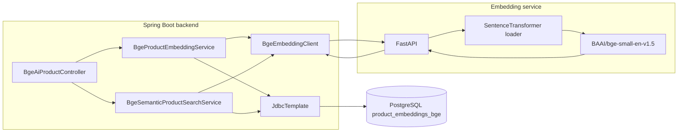
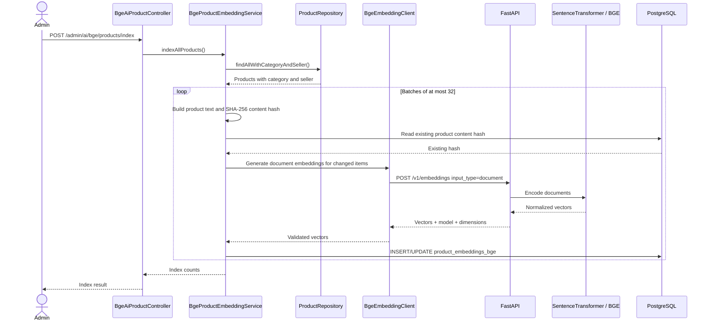
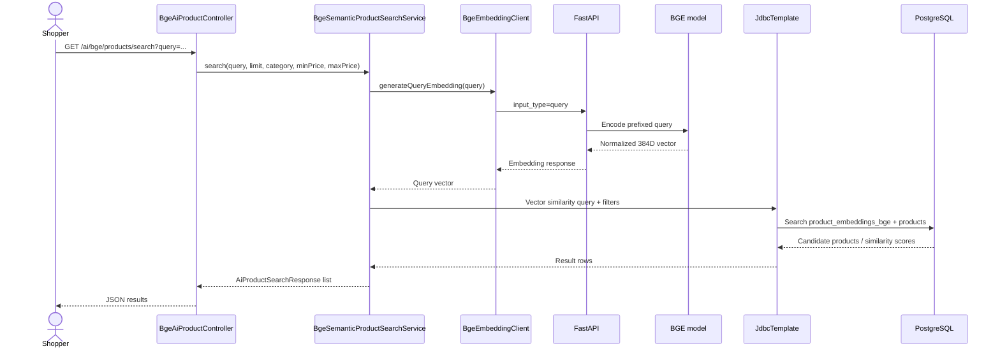

# 04 — AI and BGE Semantic Product Search

## 1. Scope

The repository has two AI embedding/search code paths. This document focuses on the BGE implementation:
- Java controller: `BgeAiProductController`
- Java orchestration: `BgeProductEmbeddingService`, `BgeSemanticProductSearchService`
- HTTP adapter: `BgeEmbeddingClient`
- Python API: `bge-embedding-service/app/main.py`
- Model default: `BAAI/bge-small-en-v1.5`
- Embedding dimensions enforced by client: 384
- Persistence/search: PostgreSQL vector column queried through `JdbcTemplate`

The presence of a separate `OpenAIEmbeddingService` is not evidence that requests use OpenAI. The BGE endpoint is documented here as a distinct route.

## 2. Service boundary

## 3. Embedding request contract

Python API:
- `GET /health` loads the model and returns service status, model, dimension and device.
- `POST /v1/embeddings` accepts a non-empty input list with maximum length 32 and `input_type` of `document` or `query`.
- Individual input text is trimmed; empty input and text longer than 4,000 characters are rejected by the Python request layer.
- Query input receives the retrieval prefix: `Represent this sentence for searching relevant products: `.
- Sentence Transformers encodes with `normalize_embeddings=True`.
- Response includes model identifier, dimensions and one vector per input.

The Java client performs additional request/response validation, including batch maximum 32, an expected 384 dimensions, configured model name, and connect/read timeouts. Java's maximum input length is configured as 8,000 characters; the Python API applies its own 4,000-character request limit.

## 4. Product indexing sequence

Hash comparison skips unchanged product documents. The code uses an upsert keyed by product ID and stores the hash, model name and update timestamp with the vector.

## 5. Query sequence

The Java search service also contains deterministic query normalization/product-type and colour vocabulary handling. Therefore the retrieval behavior should not be described as pure vector similarity alone without examining the remainder of the search SQL and ranking logic.

## 6. Design considerations

- Keep model inference isolated behind `BgeEmbeddingClient`.
- Ensure query and document embeddings use the same configured model and dimension.
- Keep indexing idempotent through the content hash and product-keyed upsert.
- Batch document embedding requests to bound memory and request size.
- Monitor FastAPI health and embedding latency separately from Spring Boot.
- Plan a re-index operation when the model or product-document construction changes.
- Verify PostgreSQL vector extension, index type and query plan from the actual database before documenting index performance claims.
