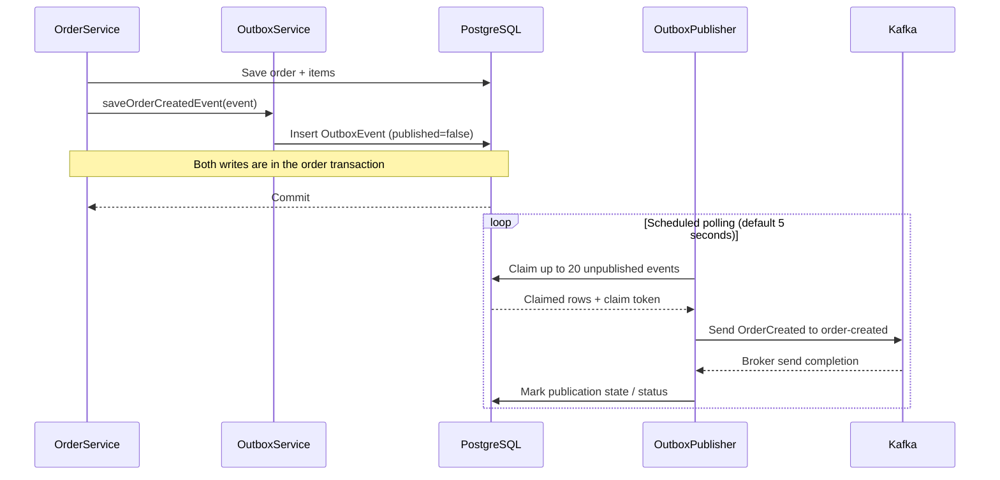
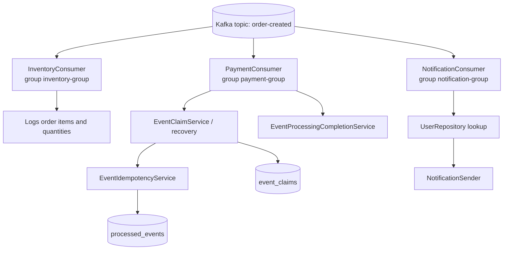

# 05 — Kafka, Transactional Outbox and Consumers

## 1. Why an outbox exists

The order service persists the order and an `OrderCreated` outbox record within the same transactional boundary. This avoids relying on a direct broker send as the only record of an event when the business transaction commits.

## 2. Write and publish path

The publisher is conditional on `shopsphere.outbox.enabled` (default matching property is enabled) and runs on a scheduled fixed delay configured by `shopsphere.outbox.poll-delay-ms` (default 5000 ms).

## 3. Consumer groups

These are independent consumer groups. Each group receives its own subscription stream; one consumer group is not a sequential step after another.

## 4. Consumer responsibilities observed in source

| Consumer | Topic / group | Observed behavior |
|---|---|---|
| `InventoryConsumer` | `order-created` / `inventory-group` | Reads event item data and logs product ID and quantity. The current listener does not adjust stock. |
| `PaymentConsumer` | `order-created` / `payment-group` | Claims event, attempts stale-claim recovery, checks processed-event state, performs simulated payment processing and completes or marks the claim failed. Concurrency configured as 3. |
| `NotificationConsumer` | `order-created` / `notification-group` | Loads customer by ID and sends order-confirmation notification. |

## 5. Idempotency and recovery

Payment consumer collaborators include:
- `EventClaimService`: acquire a tokenized claim and mark completed/failed.
- `EventClaimRecoveryService`: attempt recovery when an initial claim cannot be acquired.
- `EventIdempotencyService`: query and record processed event IDs.
- `EventProcessingCompletionService`: complete processing with claim ownership.

The model is designed to avoid duplicate work and to recover abandoned processing claims. This is application-level idempotency; it should not be presented as a blanket Kafka exactly-once guarantee.

## 6. Failure handling and DLT

The repository includes `PaymentDltConsumer`, `DeadLetterEventService`, `DeadLetterEventRepository` and Kafka error-handler configuration. These are the building blocks for dead-letter processing and operational review. Refer to the actual Kafka config and tests when documenting the configured retry count, backoff, DLT topic name or retention behavior; do not infer those exact values from class names.

## 7. Observability

The order event includes an event ID and correlation ID. Consumers copy the event correlation ID into MDC and log the topic, partition, offset and key. Preserve event IDs and correlation IDs across producer/consumer logs when troubleshooting.
