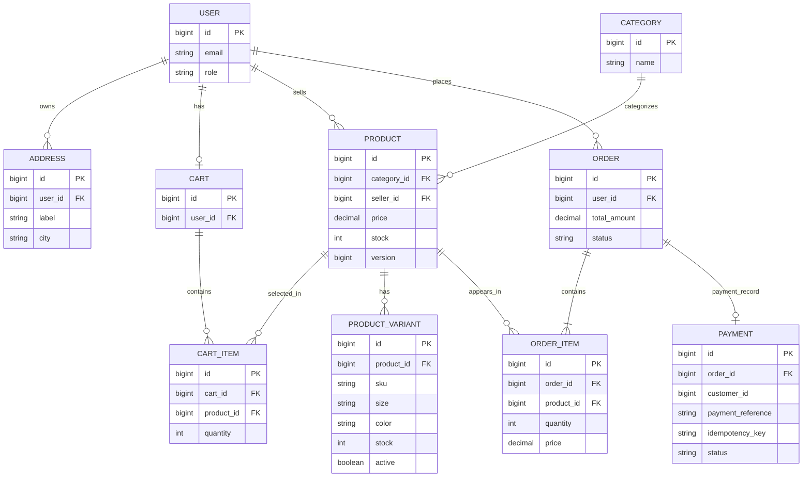

# 06 — Data Model and Persistence

## 1. Persistence approach

The backend uses Spring Data JPA / Hibernate for domain persistence and also uses `JdbcTemplate` for direct PostgreSQL vector operations. PostgreSQL is configured as the datasource through `DB_URL`, `DB_USERNAME` and `DB_PASSWORD`.

## 2. Core entity relationships

## 3. Entity notes

- `User`: customer/seller/admin identity and role.
- `Address`: address book row owned by a user.
- `Order`: belongs to a user and embeds an immutable delivery-address snapshot through `OrderAddress`.
- `OrderItem`: belongs to an order and references a product; records quantity and the price used for that order item.
- `Cart`: one-to-one user relation; has cart items with unique cart/product membership.
- `Product`: belongs to a category and may reference a seller; includes price, stock and an optimistic-lock `@Version` field.
- `ProductVariant`: belongs to a product; SKU is unique; has size, colour, price override, stock and active state.
- `Payment`: one-to-one with an order; unique payment reference and idempotency key; stores amount, method, status and verification metadata.

## 4. Operational persistence

Additional entities/tables represent:
- `OutboxEvent`: event type, aggregate ID, serialized payload, published/claim state.
- `ProcessedEvent`: event IDs already completed.
- `EventClaim`: claim owner/token and recovery/lease state.
- `DeadLetterEvent`: failed event information for review/recovery.
- Product embeddings: `product_embeddings_bge`, storing product ID, vector, content hash, model identifier and update timestamp.

## 5. Migration locations

Two migration areas exist:
- `src/main/resources/db/migration/`: V1 product color and V2 product variants.
- `database/migrations/`: additional payment, BGE embedding, variant, password-reset, seller inventory/payment audit, wishlist, colour and variant-image SQL scripts.

These locations have overlapping version labels and must not be assumed to be one automatically ordered Flyway sequence. Confirm which scripts are applied in each environment before running a migration.

## 6. Data integrity and concurrency

- Unique constraints protect user-to-cart and cart-to-product uniqueness.
- Payment has unique order, payment-reference and idempotency-key constraints.
- Product uses a JPA optimistic version field.
- Order creation reads products with a pessimistic write lock before checking/decrementing stock.
- Admin payment rejection also locks products before restoring reserved stock.
- Address ownership is checked against the authenticated user's ID.
