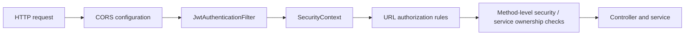

# 07 — Security and Authorization Design

## 1. Security components

- `SecurityConfig` defines the Spring Security filter chain.
- `JwtAuthenticationFilter` processes bearer JWT authentication.
- `JwtService` creates/parses tokens using externally configured secret material.
- `CustomUserDetailsService` loads user details.
- BCrypt is configured through `PasswordEncoder`.

## 2. Request security path

The filter chain is stateless and disables CSRF for the bearer-token REST API. Unauthenticated requests are configured to receive HTTP 401.

## 3. URL authorization policy observed in SecurityConfig

| Route family | Access |
|---|---|
| `/actuator/health/**` | Public |
| `/auth/**` | Public |
| Swagger UI and OpenAPI docs | Public |
| `GET /uploads/**` | Public |
| `/admin/**` | ADMIN |
| `/users/me/**` | Authenticated |
| Other `/users/**` | ADMIN |
| Product POST/PUT/PATCH/DELETE | SELLER or ADMIN |
| Product GET | Public |
| `GET /ai/products/search` and `GET /ai/bge/products/search` | Public |
| Category GET | Public |
| Category write operations | ADMIN |
| Remaining routes | Authenticated |

Role and route checks are not a substitute for resource ownership checks. Services verify ownership where needed; for example, `OrderService` ensures the order user ID matches the authenticated principal and `AddressRepository.findByIdAndUserId` ensures the delivery address belongs to that same user.

## 4. Browser CORS

The inspected CORS config lists localhost Vite development ports 5173–5178, corresponding 127.0.0.1 ports, and localhost:8082. Allowed methods are GET, POST, PUT, PATCH, DELETE and OPTIONS. Allowed headers include Authorization, Content-Type and Accept. Credentials are disabled because the API uses bearer tokens rather than cookie sessions.

## 5. Secret handling

- Datasource URL, username and password are resolved from environment variables.
- JWT signing material and external API credentials must be configured outside source control.
- Do not paste or commit real credentials.
- Rotate any credential that has ever been committed or exposed; deleting it in a later commit does not remove it from Git history.
