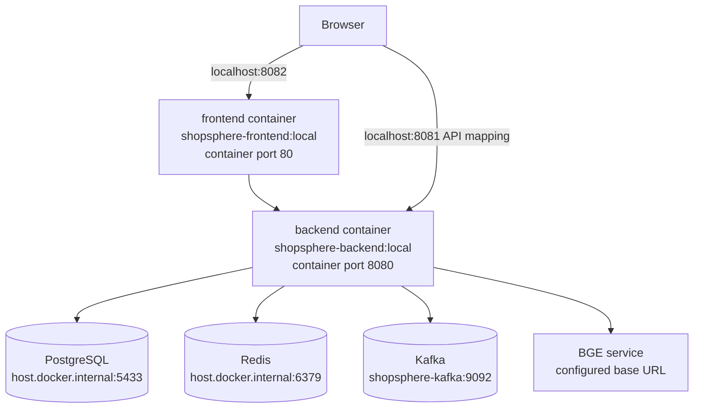
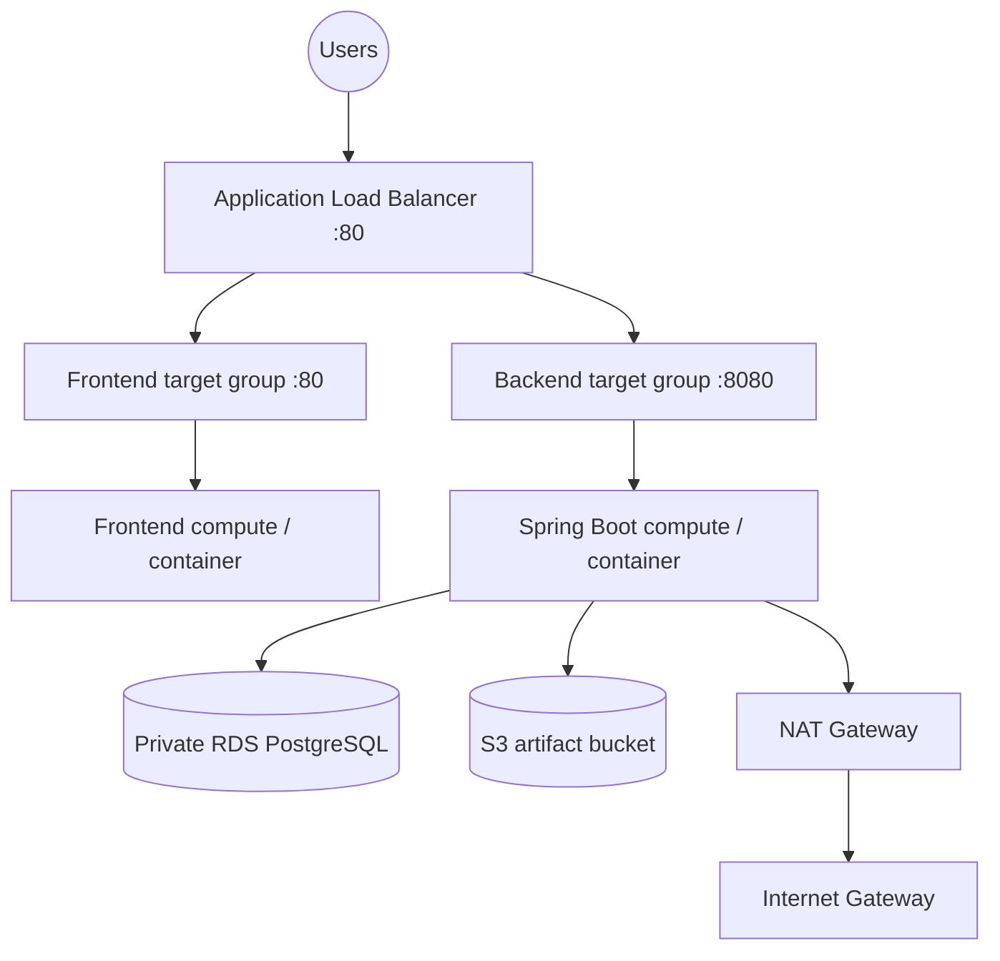

# 08 — Deployment Architecture and AWS

## 1. Local container configuration

The checked-in `compose.yaml` contains two services:
- `backend`: expects `shopsphere-backend:local`, maps host localhost:8081 to container 8080.
- `frontend`: expects `shopsphere-frontend:local`, maps host localhost:8082 to container port 80 and depends on the backend.

The Compose file sets database URL to `host.docker.internal:5433/shopsphere`, injects DB username/password from the shell environment, points Redis to the host, and references Kafka at `shopsphere-kafka:9092`. It does not declare PostgreSQL, Redis or Kafka services. A Docker network/host setup must provide those dependencies.

## 2. Local container view

## 3. AWS reference architecture

The AWS documentation in `docs/aws/` records the recovered infrastructure topology, including VPC/subnet tiers, internet gateway, NAT gateway, ALB, frontend/backend target groups, security groups, private RDS and S3. Refer to those documents for the detailed network, storage, security and recovery views.

## 4. Deployment status and caveats

This diagram is a reference view of the documented topology, not a statement that all targets are healthy or currently serving traffic. The recovery evidence reviewed on 26 November 2026 showed stopped EC2 instances and ALB targets in an invalid/stopped state at that time. A successful local build and GitHub push do not prove a live cloud deployment.

No public demo URL is claimed by this documentation. Cloud deployment should be treated as a later controlled milestone, with cost approval, health verification and a safe rollback plan.
